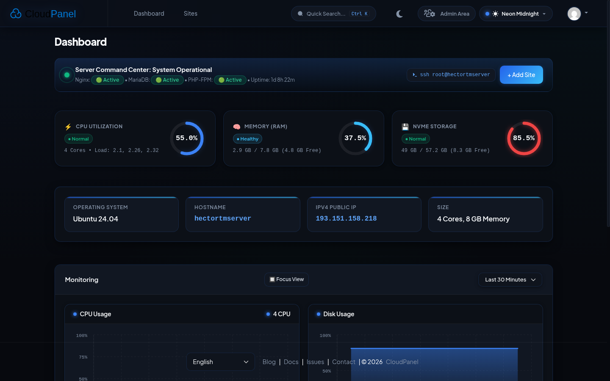

# 🌌 CloudPanel Neon Dark & UX Revolution Edition

> **A professional, high-contrast Dark UI redesign & fundamental UX modernization for [CloudPanel](https://www.cloudpanel.io).**  
> *Features 7 Designer Themes, Command Palette (Ctrl+K), Live Search/Filtering, Card/Table View Toggle, Monitoring Overhaul, and 100% Update-Proof Architecture.*

<p align="center">
  
</p>

---

## 💎 ویژگی‌های بازطراحی بنیادی UX و UI

### ۱. انقلاب در تجربه کاربری (Fundamental UX Overhaul):
* ⚡ **پالت دستورات سریع (Spotlight Command Palette - `Ctrl + K` / `Cmd + K`):**
  * جستجوی سریع و بدون ماوس در بین تمام بخش‌ها، دامنه‌ها، تنظیمات، لاگ‌ها و اکشن‌ها (مشابه Linear و Raycast).
  * تعبیه دکمه Quick Search کپسولی در هدر تاپ‌بار در کنار میانبر کیبورد.
* 🌐 **تحول بخش مدیریت سایت‌ها (Sites UX Revolution):**
  * **نوار ابزار و جستجوی آنی (Live Search & Filter Toolbar):** فیلتر فوری دامنه‌ها به محض تایپ کردن، بدون نیاز به رفرش صفحه.
  * **فیلتر تگ‌ها (Type Pills):** دسته‌بندی سریع بر اساس PHP، Node.js، Python، Reverse Proxy و Static.
  * **سوئیچ بین حالت جدولی (Table View) و حالت کارتی مدرن (Card Grid View):** امکان مشاهده دامنه‌ها به صورت کارت‌های شیک و مدرن همراه با آیکون‌های کپی سریع دامنه و مشاهده سایت در تب جدید.
* 📊 **تحول بخش داشبورد و مانیتورینگ (Executive Monitoring & Health Bar):**
  * **نوار وضعیت لحظه‌ای سرور (Live Health Ribbon):** گیج‌های دایره‌ای مدرن (Radial Gauges)، نشانگر پالس سلامت، دکمه کپی دستور SSH با یک کلیک (`ssh root@ip`).
  * **مدرن‌سازی چارت‌های Highcharts:** تبدیل خودکار خطوط ساده به **منحنی‌های نرم گرادینت‌دار (Smooth AreaSpline)** به همراه تولتیپ‌های بلورین شیشه‌ای.
  * **آمارهای محاسباتی آنی چارت‌ها:** نمایش میانگین (`Avg`) و اوج مصرف (`Peak`) زیر عنوان هر نمودار.
  * **سوئیچ چیدمان چارت‌ها:** امکان تغییر چیدمان نمودارها از حالت ۲x۲ به حالت فوکوس عرض‌کامل (Focus View).
* 🎨 **سوئیچر تم پیشرفته در تاپ‌بار (Topbar Theme Switcher):**
  * تعبیه منوی کشویی انتخاب ۷ تم اختصاصی مستقیماً روی تاپ‌بار هدر در کنار پروفایل کاربری با نشانگر رنگی زنده.
* 📱 **نوار ناوبری اختصاصی موبایل (Mobile Bottom Navigation):**
  * ناوبری مینیمال شیشه‌ای چسبیده به پایین برای گوشی‌های هوشمند با دسترسی فوری به بخش‌های اصلی.
* 🔔 **سیستم اعلان تست اختصاصی (Toast Notifications):**
  * بازخورد فوری هنگام کپی IP، دامنه‌ها و تعویض تم.

---

### ۲. پالت‌های ۷ گانه رنگ و تم (7 Designer Color Themes):
تعبیه یک **Theme Switcher** اختصاصی در نوبار برای تغییر زنده تم بدون رفرش:
1. ⚡ **Neon Midnight Blue (پیش‌فرض):** مشکی عمیق (`#07090e`) با آبی نئونی الکتریک (`#3b82f6`).
2. 🌊 **Cyber Cyan:** سرمه‌ای اقیانوسی (`#050b14`) با نور فیروزه‌ای لیزری.
3. 🌑 **AMOLED Pure:** مشکی مطلق (`#000000`) برای بالاترین کنتراست نمایشگرهای OLED.
4. 🟢 **Emerald Matrix:** تیره ابسیدین با سبز نئونی سایبری و هکری (`#10b981`).
5. 🟣 **Violet Royale:** سرمه‌ای کهکشانی با بنفش سلطنتی سینت‌ویو (`#a855f7`).
6. 🟠 **Sunset Amber:** تیره بازالتی گرم با نور کهربایی آتشین خورشیدی (`#f59e0b`).
7. 🔴 **Crimson Phantom:** تیره تیتانیومی استیلث با قرمز نئونی شارپ (`#ef4444`).

---

## 🚀 نصب سریع با یک دستور (One-Click Installation)

روی سروری که CloudPanel روی آن نصب است، دستور زیر را با کاربر root یا sudo اجرا کنید:

```bash
git clone https://github.com/ArianChaghazardi/cloudpanel-neon-dark.git /tmp/cloudpanel-neon-dark \
  && sudo bash /tmp/cloudpanel-neon-dark/install.sh \
  && rm -rf /tmp/cloudpanel-neon-dark
```

سپس وارد آدرس پنل کلودپنل خود شوید و کلیدهای **`Ctrl + F5`** (Hard Refresh) را فشار دهید.

---

## 📂 ساختار فایل‌های پروژه (Architecture)

```text
cloudpanel-neon-dark/
├── assets/
│   ├── css/
│   │   ├── variables.css      # توکن‌های طراحی و پالت‌های ۷ تم اختصاصی
│   │   ├── base.css           # بازنشانی استایل‌ها، اسکرول‌بار سفارشی و تایپوگرافی
│   │   ├── layout.css         # استایل هدر شیشه‌ای، سایدبار و نویگیشن
│   │   ├── components.css     # کارت‌ها، جداول، اینپوت‌ها، دکمه‌ها و بج‌ها
│   │   ├── dashboard.css      # استایل‌های چارت‌ها و باکس‌های اطلاعات سرور
│   │   ├── ux-revolution.css  # کامپوننت‌های مدرن UX: پالت Ctrl+K، فیلتر سایت‌ها، داک شناور و نوتیفیکیشن‌ها
│   │   └── theme.css          # استایل‌شیت تجمیعی برای بارگذاری مستقیم
│   └── js/
│       └── enhancer.js        # موتور پالت دستورات، فیلتر سایت‌ها، چارت‌های داینامیک و تم‌ها
├── preview/
│   └── demo.html              # محیط تست زنده و آفلاین با تمام تعاملات UX
├── install.sh                 # اسکریپت نصب و پیکربندی خودکار Nginx و APT Hook
├── uninstall.sh               # اسکریپت حذف تمیز و بازگشت به حالت اولیه
└── README.md
```

---

## 🛡️ مقاومت ۱۰۰٪ در برابر آپدیت‌های کلودپنل (Update-Proof)

* **بدون تغییر در سورس کد PHP:** فایل‌های هسته کلودپنل بازنویسی نمی‌شوند.
* **تزریق Nginx `sub_filter`:** به صورت تمیز در کانفیگ `clp-nginx` قرار می‌گیرد.
* **هوک سیستمی APT (`/etc/apt/apt.conf.d/99cloudpanel-theme`):** در صورت آپدیت پکیج کلودپنل، فایل‌های اختصاصی و قوانین Nginx خودکار پایدار می‌مانند.

---

## 🔄 حذف و بازگشت به حالت اولیه (Uninstall)

```bash
sudo bash uninstall.sh
```

---

## 📄 مجوز (License)

توسعه‌داده‌شده برای اهداف شخصی و سازمانی. این پروژه مستقل از تیم رسمی CloudPanel است.
